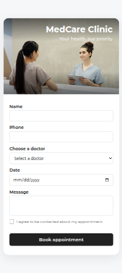
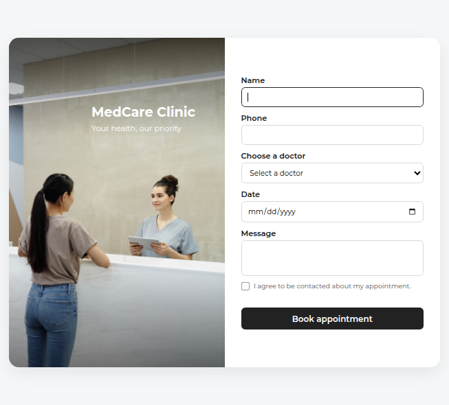
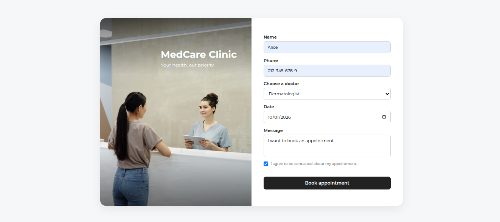
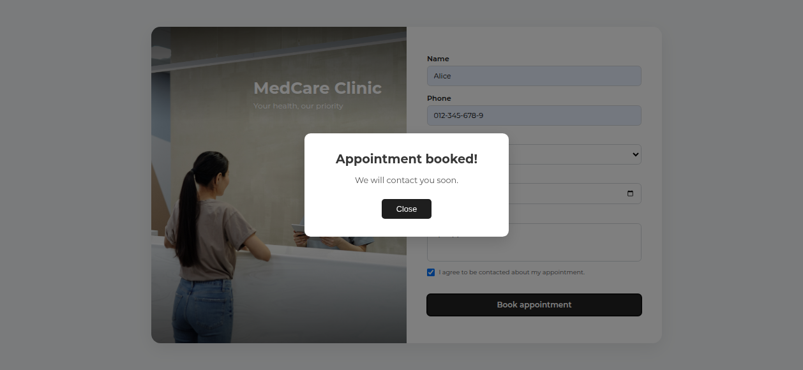

# MedCare Clinic

A responsive medical clinic website built with React, Node.js, Express, and PostgreSQL.

## Screenshots

## Features

* Appointment booking form
* Doctor selection
* Appointment date selection
* Form validation
* PostgreSQL database integration
* Appointment confirmation modal
* Responsive design

## Technologies

* React
* JavaScript
* CSS
* Node.js
* Express
* PostgreSQL

## Getting Started

1. Clone the repository.
2. Install the dependencies in the frontend and backend directories.
3. Configure the database connection using environment variables.
4. Start the backend server.
5. Start the React development server.

## Status

Work in progress.
